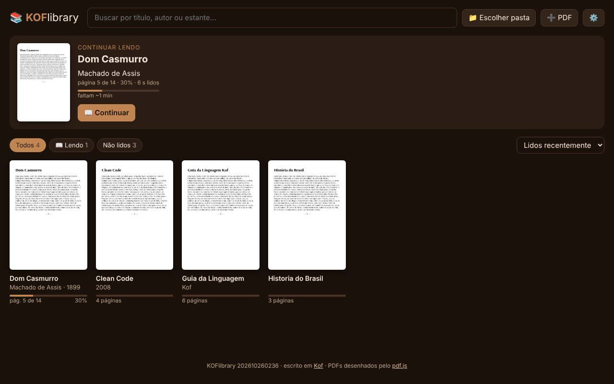
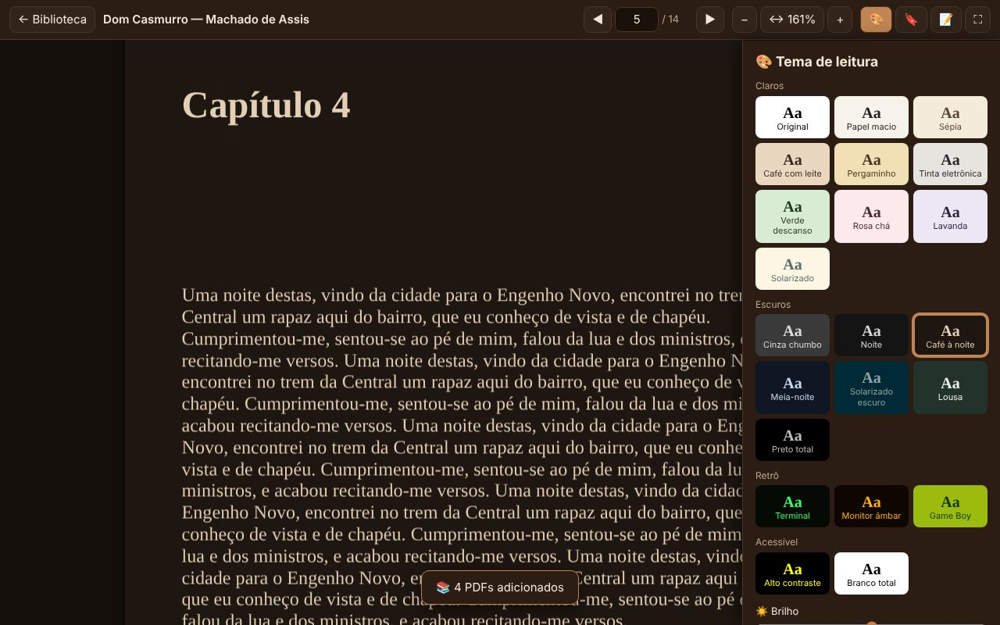
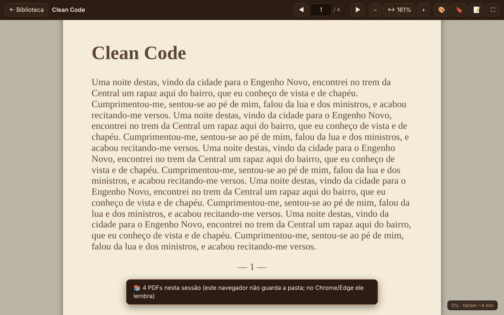

# 📚 KOFlibrary

**A sua biblioteca de PDFs: arraste a pasta, leia com o tema que descansa o olho, anote e continue de onde parou.**
Irmão do [KOFstation](https://github.com/Marcelao98/KOFStation): o que o KOFstation é pros jogos, o KOFlibrary é pros livros.
O núcleo é escrito em [Kof](https://github.com/KofLang/Kof4j), linguagem brasileira parceira do projeto, e os PDFs são desenhados pelo
[pdf.js](https://github.com/mozilla/pdf.js) (Mozilla).

<p align="center"></p>

## ⬇️ Como usar

1. Baixe o [**KOFlibrary.html**](https://raw.githubusercontent.com/Marcelao98/KOFLibrary/main/publicado/KOFlibrary.html)
   (botão direito → *Salvar link como*).
2. Dois cliques nele: abre no **Chrome** ou no **Edge** (no Windows, no Linux ou no Mac). Não instala nada, não precisa de internet.
3. Arraste a pasta dos seus livros pra janela (ou clique em **📁 Escolher pasta**). Pronto.

Quer que abra numa janela própria, sem barra de endereço? Deixe do lado do html o
[`KOFlibrary.bat`](publicado/KOFlibrary.bat) (Windows) ou o [`koflibrary.sh`](publicado/koflibrary.sh) (Linux) e abra por ele.

> Seus PDFs não saem do computador. O KOFlibrary guarda no navegador só o que é dele: capas, progresso, notas e temas.
> A pasta fica lembrada (no Chrome/Edge); se o navegador pedir, é só clicar em **Liberar a pasta**.

## 📊 Estatísticas, metas e conquistas

Botão **📊** na biblioteca:
- **Hoje, semana, 🔥 sequência de dias lendo** (conta a partir de 5 min por dia; o dia de hoje só quebra a sequência
  quando acaba) e quantos você terminou no ano.
- **🎯 Metas do seu jeito:** você escolhe o período (dia, semana, mês ou ano), o quê (livros/volumes terminados,
  páginas ou minutos) e quanto, e pode ter várias. Cada uma diz se você está adiantado ou atrasado e quando bate,
  nesse ritmo.
- **Gráficos** dos últimos 7 e 30 dias e o **calendário do ano** (estilo GitHub).
- **✨ Retrospectiva:** mais lidos, seu horário (🦉 coruja, 🌙 leitor da noite...), mês recorde.
- **🏆 17 conquistas** (Semana de fogo, Maratona, Otaku, Clássico, Em todo lugar...).
- **🖼️ Cartão do mês:** uma imagem pronta pra postar.

PC e celular contam separado e somam na sincronia (nada é contado duas vezes); o backup leva tudo junto.

## 💾 Backup

Progresso, notas, marcadores e temas ficam guardados no navegador (ou no app do celular). Pra não perder nada:
- **⚙️ → Backup → Ligar**: o KOFlibrary grava um `KOFlibrary-backup.koflib` **dentro da sua pasta de livros** sempre que
  algo muda. Limpou o navegador, trocou de PC ou reinstalou o app? Escolha a pasta de novo e tudo volta sozinho.
  No celular o backup automático já vem ligado (se a pasta tiver sido escolhida de novo depois desta versão).
- **⬇️ Exportar / ⬆️ Importar backup**: o mesmo arquivo, pra guardar onde quiser. Importar junta com o que já tem
  (vale o mais novo de cada livro), então importar duas vezes não estraga nada.
- **🐞 Relatar problema** (em ⚙️): junta versão, aparelho e os últimos erros num texto pra copiar e mandar.

## 🗾 Mangá e HQ

Além de PDF, o KOFlibrary lê **mangá e HQ em `.cbz` e `.cbr`**. É só deixar na mesma pasta dos livros (uma subpasta por
série fica organizado).

- **Direita → esquerda** (mangá japonês, o padrão): a seta ←, o toque na beirada esquerda e arrastar pra direita avançam.
  Também tem **esquerda → direita** (HQ) e **⬇️ Webtoon** (rolagem vertical, pra manhwa), no painel 🎨.
- **Duas páginas lado a lado** com a tela deitada; capa e página dupla desenhada ficam sozinhas.
- **Séries:** os capítulos de uma série viram um cartão só ("3 de 110 lidos"); dentro dele os capítulos ficam em ordem
  (o núcleo em Kof entende "One Piece v03 c025", "Cap. 101.5", "Vol.12"...). No fim do capítulo: **Próximo capítulo →**.
- **Temas** repintam a página do mangá também (Noite e Sépia ficam ótimos no preto e branco) e dá pra **cortar as bordas
  brancas**.
- **🔲 Quadro a quadro** (padrão no celular em pé): cada toque leva ao próximo quadro, na ordem japonesa, com zoom pra
  caber na tela; no último quadro vai pra próxima página. O núcleo em Kof ([`Quadros.kf`](nucleo/Quadros.kf)) acha os
  quadros pelas calhas brancas. **Toque duplo** no meio mostra a página inteira (e volta). Página sem quadros
  (splash) aparece inteira; quadros com calha inclinada podem vir juntos num só.
- **✨ HD:** scan pequeno em tela grande é aumentado na placa de vídeo (bicúbico + nitidez só nas bordas), o traço fica
  mais limpo. Liga sozinho quando a imagem cresce mais de 1,5×.
- **Duplo clique/toque** fora do quadro a quadro dá zoom de 2,5× no ponto (de novo, volta).
- O `.cbz` é lido aos pedaços: só a imagem que vai aparecer sai do arquivo (o zip é lido pelo [`Zip.kf`](nucleo/Zip.kf)).

## 📱 No celular (Android)

1. Baixe o [**KOFlibrary.apk**](https://raw.githubusercontent.com/Marcelao98/KOFLibrary/main/android/apk/KOFlibrary.apk) no celular
   e instale (o Android pede uma vez pra liberar "instalar apps desta fonte"). Android 7 ou mais novo.
2. Toque em **📁** e escolha a pasta dos seus livros no celular, e/ou mande os livros do PC (abaixo).
3. Leia: toque no meio esconde as barras, nas beiradas (ou arrastando pro lado) vira a página, pinça dá zoom e as
   **teclas de volume viram a página**. "Abrir com → KOFlibrary" abre qualquer PDF do WhatsApp, Drive, Arquivos...

**Livros do PC no celular:** com os dois na mesma Wi-Fi, toque em **📱** no celular: aparecem um endereço e uma senha.
No PC, clique em **📱**, digite os dois e escolha o que mandar (os que você está lendo, todos ou só o progresso).
Pronto: o PC manda os PDFs que faltam e **o progresso, as notas e os marcadores ficam iguais nos dois**, sozinho, a cada
2 minutos enquanto o KOFlibrary estiver aberto no PC e no celular. Nada passa pela internet.
O app se atualiza sozinho quando sai versão nova.

> Se o PC não achar o celular: abra `http://<endereço>` no navegador do PC. Se aparecer "✅ Celular achado", a rede
> está ok e é o navegador bloqueando a página: permita "Dispositivos da rede local" no cadeado ao lado do endereço.

## ✨ O que tem na versão 1

| | |
|---|---|
| 📁 **Biblioteca** | arraste a pasta ou escolha uma vez: acha todos os PDFs, inclusive nas subpastas, que viram **estantes**. PDF solto também (➕ PDF), que fica guardado no navegador |
| 🖼️ **Capas** | a primeira página vira a capa; título, autor e ano saem do nome do arquivo (`Machado_de_Assis - Dom Casmurro (1899).pdf` → *Dom Casmurro*, *Machado de Assis*, 1899) e dá pra editar ✏️ |
| 🔎 **Busca** | sem acento e com as palavras em qualquer ordem (`casmurro dom` acha); filtros **Lendo**, **Não lidos**, **Terminados**, **⭐ Favoritos**; ordem por recentes, título, autor, progresso |
| 📖 **Continuar lendo** | o livro que você estava lendo no topo, com a página, o % e **quanto falta pelo seu ritmo** |
| 🎨 **22 temas de leitura** | o tema **repinta a página do PDF**: Sépia, Café com leite, Pergaminho, Tinta eletrônica, Verde descanso, Noite, Café à noite, Meia-noite, Lousa, Preto total, Terminal, Monitor âmbar, Game Boy, Alto contraste... O texto continua nítido e as figuras coloridas não ficam em negativo nos temas escuros |
| 🌙 **Ajustes** | brilho, contraste e **luz quente** (tira o azul pra ler de noite); vale pra todos os livros ou **só pra um** |
| 🔖 **Marcadores e 📝 notas** | marque páginas e escreva notas; tudo numa lista lateral e **exporta pra Markdown (.md)** |
| ⏱️ **Lembra tudo** | página onde parou, zoom, tempo lido (só conta enquanto você está lendo) |
| ⌨️ **Atalhos** | `←` `→` páginas · `+` `−` zoom · `0` ajustar · `T` temas · `B` marcador · `N` notas · `F` tela cheia · `Esc` voltar · `Ctrl+roda` zoom |
| ☕ **Tema do app** | Café (o do KOFstation), Café claro, Noite, Floresta, Papel, Vinho |

<p align="center">
  
  
</p>

## 🧠 O que é feito em Kof

Tudo que é conta mora em [`nucleo/`](nucleo), compilado pra JavaScript pelo alvo `js` do Kof:

| arquivo | faz |
|---|---|
| [`Pintor.kf`](nucleo/Pintor.kf) | repinta os pontos da página: o tom de cinza escolhe a cor entre a tinta e o papel do tema (tabela de 256 cores); ponto colorido mantém o matiz; luz quente, brilho e contraste |
| [`Temas.kf`](nucleo/Temas.kf) | os 22 temas (papel e tinta) |
| [`Nome.kf`](nucleo/Nome.kf) | título, autor e ano tirados do nome do arquivo |
| [`Busca.kf`](nucleo/Busca.kf) | normaliza (sem acento) e confere as palavras em qualquer ordem |
| [`Leitura.kf`](nucleo/Leitura.kf) | %, tempo lido e "faltam ~2 h 10 min" pelo seu ritmo |
| [`Cor.kf`](nucleo/Cor.kf) | contas de cor |
| [`Zip.kf`](nucleo/Zip.kf) | lê o índice do `.cbz` (zip) e diz onde está cada página; CRC-32 |
| [`Capitulo.kf`](nucleo/Capitulo.kf) | série, volume e capítulo do nome do arquivo e a ordem natural (2 antes de 10) |
| [`Bordas.kf`](nucleo/Bordas.kf) | acha as bordas brancas da página de mangá pra cortar |

A interface (biblioteca, leitor, painéis) está em [`web/`](web); o app Android (uma casca em Java com o mesmo html) em [`android/`](android).

## 🔧 Compilar

Precisa do Kof 0.6.6 (Java 25) e de python3:

```bash
git clone https://github.com/KofLang/Kof4j && cd Kof4j
mvn -q -pl kof-cli -am package -DskipTests && cp kof-cli/target/kof-cli-*.jar lib/kof.jar
export PATH=$PWD/bin:$PATH
cd ../KOFLibrary && web/compilar.sh          # -> dist/KOFlibrary.html
node testes/gerar-pdfs.cjs /tmp/pdfs && node testes/navegador.cjs dist/KOFlibrary.html /tmp/pdfs /tmp/prints
```

## 🗺️ Próximas versões (ideias)

- ✍️ **marca-texto**: selecionar o texto e grifar em cores, com nota no grifo
- 🔍 busca dentro do livro e **sumário** do PDF
- ✂️ cortar as margens brancas (o texto fica maior no celular)
- 📊 estatísticas: tempo lido por dia, sequência de dias lendo, meta do ano
- 📖 modo livro (duas páginas lado a lado) e modo página única com virar de página
- 🔊 ler em voz alta (voz do próprio sistema)
- 📚 EPUB, MOBI, AZW3, FB2 (fase 2) e TXT/MD (fase 3)

## Licenças

KOFlibrary: código do projeto. pdf.js: Apache-2.0 ([`web/vendor/pdfjs/LICENSE`](web/vendor/pdfjs/LICENSE)), com os decodificadores
JBIG2/OpenJPEG/QCMS em WebAssembly (licenças em [`web/vendor/pdfjs/wasm`](web/vendor/pdfjs/wasm)).
`.cbr`: [node-unrar-js](https://github.com/YuJianrong/node-unrar.js) (MIT) com o UnRAR da RARLAB em WebAssembly (licença do
UnRAR: só descompactar), em [`web/vendor/unrar`](web/vendor/unrar).
